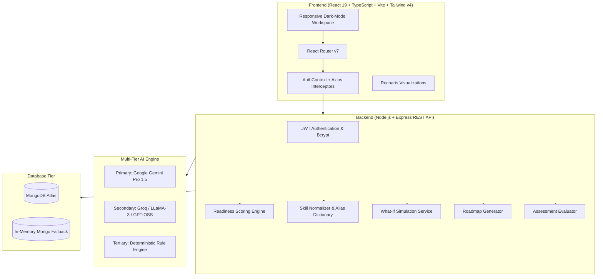

# 🚀 SkillBridge AI — Career & Skill-to-Job Intelligence Platform

<div align="center">


**An intelligent, deterministic full-stack platform that transforms resumes and target job market demands into transparent readiness scores, prioritized skill gap breakdowns, what-if simulators, and AI-curated interactive learning roadmaps.**

[Key Features](#-key-features) • [Architecture](#-architecture--design) • [Quickstart](#-getting-started) • [API Reference](#-api-endpoints) • [Tech Stack](#-technology-stack)

</div>

---

## 🌟 Executive Overview

**SkillBridge AI** is an enterprise-grade Career Intelligence Platform built on the MERN stack with multi-tier LLM integrations. It eliminates ambiguity in tech hiring by providing candidates with:
1. **Deterministic Skill-to-Job Readiness Scoring** using weighted rubric evaluations (0–100%) rather than black-box AI approximations.
2. **Deep Resume Parsing & Taxonomy Normalization** across 200+ canonical technical skill aliases.
3. **Interactive What-If Skill Simulator** showing real-time projected score jumps when new skills or certifications are acquired.
4. **Adaptive Milestone Learning Roadmaps** with curated study resources, actionable tasks, and progress tracking.
5. **Interactive Skill Verification Assessments** generating randomized technical multiple-choice quizzes with live timers, instant scoring, and verified credential badging.
6. **AI Career Strategist Advisor** offering streaming conversational career guidance and resume optimization tips.

---

## 🎯 Key Features

### 📄 1. AI Resume Extraction & Canonical Skill Aggregation
- Upload PDF resumes with automated multi-format buffer decoding.
- Extracts experience, education, key projects, certifications, and technical skills.
- Aggregates resume evidence, manual profile declarations, and assessment results into a single **Active Normalized Skill Inventory**.

### 🎯 2. Market Job Ingestion & Parsing
- Ingest job descriptions via raw text, structured forms, or standard industry benchmarks (*Full Stack Engineer*, *AI Full Stack Developer*).
- Deconstructs requirements into required vs. preferred skills, required proficiency levels (1–5), and experience thresholds.

### 📊 3. Deterministic 4-Pillar Readiness Engine
- **Technical Skill Match (45% Weight):** Evaluates proficiency level vs. requirement across primary tech stacks.
- **Experience Alignment (25% Weight):** Quantifies career seniority and years of domain experience.
- **Project & Execution Relevance (20% Weight):** Scored based on project depth and technology stack overlap.
- **Verified Evidence (10% Weight):** Bonus awarded for validated assessment badges and verified profile proofs.
- **Transparent Mathematical Explainability:** Shows exact sub-score contributions and formula breakdowns.

### 🔮 4. Real-Time What-If Skill Simulator
- Select any prospective skill (e.g. *Docker*, *AWS*, *GraphQL*, *FastAPI*), toggle target proficiency levels (1–5), and add hypothetical project experience.
- Instant calculation of projected overall readiness jumps and ROI for time invested.

### 🗺️ 5. Personalized Gap-Closure Learning Roadmaps
- Formulates customized, step-by-step milestone learning roadmaps based on priority gaps.
- Complete with estimated timelines, interactive task checklists, and curated study materials.

### ✍️ 6. Automated Technical Skill Assessments
- Randomized 5-question technical MCQs generated on-demand for any skill category.
- Live countdown timers, difficulty ratings (Beginner, Intermediate, Advanced), instant evaluation, and automated profile verification.

### 💼 7. Job Application Funnel & Portfolio Tracker
- Track applications across 7 lifecycle stages (*Saved*, *Applied*, *Assessment*, *Interview*, *Offer*, *Accepted*, *Rejected*).
- Real-time conversion metrics and salary expectation tracking.

### 🤖 8. AI Career Strategist Chatbot
- Context-aware advisor that analyzes candidate's real profile, skill inventory, and target roles to provide personalized career recommendations.
- Rich Markdown styling with code highlights and actionable action plans.

---

## 🏗️ Architecture & Design



---

## 💻 Technology Stack

### Frontend
- **Framework:** React 19 + TypeScript + Vite
- **Styling:** Tailwind CSS v4 (Custom dark palette, glassmorphism, glowing accents)
- **Icons:** Lucide React
- **Data Visualization:** Recharts
- **Forms & Validation:** React Hook Form + Zod
- **Markdown:** React Markdown + Remark GFM
- **Routing:** React Router v7

### Backend
- **Runtime:** Node.js + Express.js
- **Database:** MongoDB with Mongoose ODM (Transparent fallback to `mongodb-memory-server` for zero-configuration local development)
- **Security:** JWT (JSON Web Tokens), Bcrypt.js, CORS
- **PDF Extraction:** `pdf-parse`
- **Validation:** Zod Schema Validation Middleware

### Multi-Tier AI Strategy
- **Tier 1 (Primary):** Google Gemini Pro / Flash API
- **Tier 2 (Fast Secondary):** Groq Cloud API
- **Tier 3 (Zero-Failure Fallback):** High-precision local heuristic rules and canonical skill graphs

---

## 🚀 Getting Started

### Prerequisites
- Node.js (v18+ recommended)
- npm or yarn
- MongoDB (Optional: local connection, Atlas connection, or automatic in-memory fallback)

### 1. Clone the Repository
```bash
git clone https://github.com/Arvindkumar-star/SkillBridgeAI.git
cd SkillBridgeAI
```

### 2. Configure Environment Variables
Create a `.env` file in the `server` directory:

```bash
# In server/.env
PORT=5000
MONGODB_URI=mongodb://127.0.0.1:27017/skill_to_job
JWT_SECRET=your_secure_jwt_secret_key_2026
JWT_EXPIRES_IN=7d
NODE_ENV=development

# AI API Keys (Optional but recommended for live LLM extraction)
AI_PROVIDER=groq
GROQ_API_KEY=your_groq_api_key_here
GEMINI_API_KEY=your_gemini_api_key_here
```

### 3. Install Dependencies
```bash
# Root and backend dependencies
cd server
npm install

# Frontend dependencies
cd ../client
npm install
```

### 4. Run Locally

**Start the Backend Server:**
```bash
cd server
npm start
# Server runs on http://localhost:5000
```

**Start the Frontend Dev Server:**
```bash
cd client
npm run dev
# Client runs on http://localhost:3000
```

---

## 📡 API Endpoints

| Category | Method | Endpoint | Description |
|---|---|---|---|
| **Auth** | `POST` | `/api/auth/register` | Register new user account |
| | `POST` | `/api/auth/login` | Authenticate and obtain JWT token |
| | `GET` | `/api/auth/me` | Fetch authenticated user context |
| **Profile** | `GET` | `/api/users/profile` | Get aggregated normalized skill profile |
| | `PUT` | `/api/users/profile` | Update demographics and target roles |
| | `POST` | `/api/users/skills` | Add manual skill with level (1–5) |
| | `DELETE`| `/api/users/skills/:name` | Remove skill from profile inventory |
| **Resumes** | `POST` | `/api/resumes/upload` | Upload & parse PDF resume with AI |
| | `GET` | `/api/resumes` | List user resumes |
| | `DELETE`| `/api/resumes/:id` | Delete resume document |
| **Jobs** | `GET` | `/api/jobs` | Get target jobs (with auto-seeded benchmarks) |
| | `POST` | `/api/jobs` | Create new target job posting |
| | `POST` | `/api/jobs/parse` | Parse job description from raw text |
| **Analysis** | `POST` | `/api/analyses/run` | Run 4-pillar readiness calculation |
| | `POST` | `/api/analyses/simulate`| Run what-if skill simulation |
| | `GET` | `/api/analyses/history` | Get past readiness evaluation trends |
| **Roadmaps**| `POST` | `/api/roadmaps/generate`| Generate AI personalized roadmap |
| | `GET` | `/api/roadmaps` | List all customized user roadmaps |
| | `PATCH`| `/api/roadmaps/:id/tasks`| Toggle milestone task completion |
| **Assessments**| `POST`| `/api/assessments/start`| Generate technical quiz |
| | `POST` | `/api/assessments/:id/submit`| Submit answers and calculate score |
| **Applications**| `GET` | `/api/applications` | List tracked job applications |
| | `POST` | `/api/applications` | Track new job application |
| **Assistant** | `POST` | `/api/assistant/chat` | AI Career Strategist Chatbot |

---

## 🛡️ Security & Privacy
- **Zero Raw Credential Exposure:** `.env` and confidential configuration files are permanently excluded via `.gitignore`.
- **JWT Authentication:** Strict token authorization and route protection middleware on all non-public endpoints.
- **Input Validation:** Zod schemas validate all API request payloads before execution.

---

## 👨‍💻 Author & Contributions

Built with ❤️ by **[Arvind Kumar](https://github.com/Arvindkumar-star)**

Contributions, issues, and feature requests are welcome! Feel free to check the [issues page](https://github.com/Arvindkumar-star/SkillBridgeAI/issues).

---

<div align="center">
  <sub>SkillBridge AI © 2026. Empowering developers to navigate career growth with clarity and intelligence.</sub>
</div>
